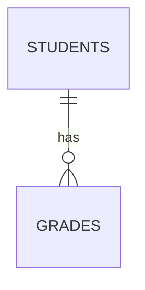

# AI-Engineer-Journey

## Overview

A Python and SQL project focused on building practical software engineering skills for AI Engineering.

This project covers Python fundamentals, object-oriented programming, dataclasses, type hints, modular code organization, JSON and CSV processing, error handling, logging, automated testing, and PostgreSQL.

The Grade Manager CLI application analyzes student grades from CSV files and provides average, top, and summary operations.

The SQL portfolio demonstrates practical database operations, including joins, aggregations, subqueries, CTEs, and window functions.

## Installation

Clone the repository:

```bash
git clone https://github.com/alvanoghlu/AI-Engineer-Journey.git
cd AI-Engineer-Journey
```

Create a virtual environment:

```bash
python -m venv .venv
```

Activate the virtual environment on Windows PowerShell:

```powershell
.venv\Scripts\Activate.ps1
```

Install dependencies:

```bash
python -m pip install -r requirements.txt
```

## Usage

Run the application using the following commands:

Calculate student averages:

```bash
python src/grade_cli.py average --file data/grades.csv
```

Find the top student:

```bash
python src/grade_cli.py top --file data/grades.csv
```

Display a summary of student grades:

```bash
python src/grade_cli.py summary --file data/grades.csv
```

Display available commands and options:

```bash
python src/grade_cli.py --help
```

## SQL Portfolio

This project includes a PostgreSQL school database designed to practice SQL queries and database operations.

### Database Schema

The database contains two related tables:

- **students**: Stores student IDs and names.
- **grades**: Stores student grades, subjects, and references students through `student_id`.

### Database Relationship



### SQL Topics

The SQL portfolio includes practical examples of:

- SELECT queries and filtering
- INNER JOIN and LEFT JOIN
- Aggregate functions and GROUP BY
- HAVING clause
- Subqueries and CTEs
- Window functions
- ROW_NUMBER, RANK, and DENSE_RANK
- Running totals and LAG

### Run SQL Scripts

Create the PostgreSQL database:

```bash
psql -U postgres -d postgres -c "CREATE DATABASE school;"
```

Create tables and insert sample data:

```bash
psql -U postgres -d school -f sql/school.sql
```

Execute the SQL portfolio queries:

```bash
psql -U postgres -d school -f sql/queries.sql
```

## Project Structure

```text
AI-Engineer-Journey/
│
├── archive/            # Previous exercises and practice files
├── data/               # CSV and JSON data files
├── sql/                # PostgreSQL database schema and SQL queries
│   ├── school.sql
│   ├── queries.sql
│   ├── queries_basic.sql
│   ├── queries_join.sql
│   ├── queries_aggregate.sql
│   ├── queries_cte.sql
│   ├── queries_window.sql
│   └── interview.sql
├── src/                # Application source code
├── tests/              # Automated tests
│
├── pytest.ini          # Pytest configuration
├── requirements.txt    # Project dependencies
└── README.md           # Project documentation
```

## Tests

Run all automated tests:

```bash
python -m pytest -v
```

## Code Quality

Check code quality with Ruff:

```bash
python -m ruff check .
```

Format code with Ruff:

```bash
python -m ruff format .
```

Check type hints with Mypy:

```bash
python -m mypy .
```